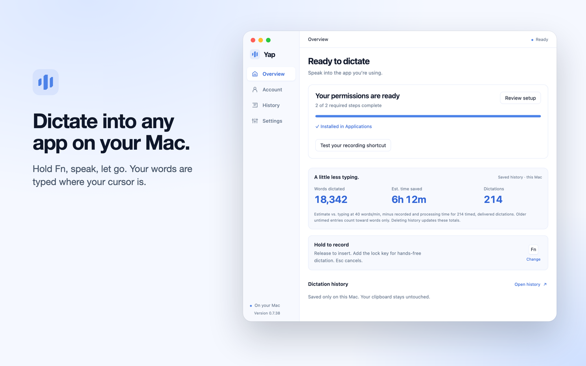
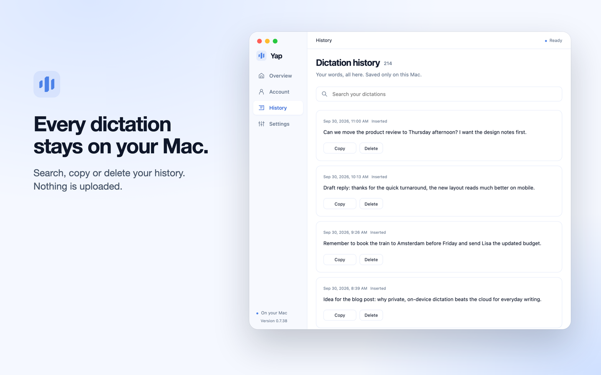

# Yap: private voice dictation for Mac, Windows and Android

Hold a shortcut, speak, and let go. Yap turns your speech into clean, punctuated text and types it into the app you are using: email, documents, chat, browsers, terminals and coding agents. Speech recognition runs on your own device, so your recordings are not uploaded.

**[Download Yap](https://yapapp.cc/download?utm_source=github&utm_medium=readme&utm_campaign=github-readme-oct2026)** · [Website](https://yapapp.cc/?utm_source=github&utm_medium=readme&utm_campaign=github-readme-oct2026) · [Pricing](https://yapapp.cc/pricing?utm_source=github&utm_medium=readme&utm_campaign=github-readme-oct2026) · [Support](https://yapapp.cc/support?utm_source=github&utm_medium=readme&utm_campaign=github-readme-oct2026)

This repository hosts the Windows and Android installers of each release, plus press images. Yap is a commercial app, not open source.

## Download

| Device | Requirements | Get it |
|---|---|---|
| Mac | Apple silicon (M1 or later), macOS 13 or later | [Download for Mac](https://yapapp.cc/download?utm_source=github&utm_medium=readme&utm_campaign=github-readme-oct2026) (Developer ID signed and Apple notarized) |
| Windows | Windows 10 or 11, 64-bit (x64) | [Latest installer](https://yapapp.cc/api/desktop/download?platform=windows) |
| Windows on Arm | Windows 11 on Snapdragon and other Arm64 PCs, native build | [Latest Arm64 installer](https://yapapp.cc/api/desktop/download?platform=windows&arch=arm64) |
| Android | Android 10 or later | [Latest APK](https://yapapp.cc/api/desktop/download?platform=android) |
| iPhone | iOS 17 or later | [Public beta on TestFlight](https://testflight.apple.com/join/uc2u5VXe) |

Each link always points to the newest verified release. Older installers are attached to the [releases](https://github.com/founden-bot/yap-releases/releases), with SHA-256 checksums in each release's notes. Setup steps for every device: [yapapp.cc/download](https://yapapp.cc/download?utm_source=github&utm_medium=readme&utm_campaign=github-readme-oct2026).

## How it works

- **Mac:** hold Fn, speak, release. Press Fn + Space to keep recording hands-free, then tap Fn to finish.
- **Windows:** hold Ctrl + Win, speak, release. Press Space while holding to keep recording hands-free.
- **Phone:** the Yap keyboard puts the same dictation in every app.
- Yap adds punctuation and capitals and removes filler words such as "um" and "uh".
- It types where your cursor is, including terminals and coding agents such as Claude Code. It never types into password fields.
- Press Esc to stop a recording and keep it in History instead of typing it.

## Private by design

- Speech recognition runs on your device (NVIDIA Parakeet). Your audio is never uploaded.
- After a one-time download of the speech model (about 0.7 GB on Windows and Android, 1.4 GB on a Mac), recognition works offline. The app checks your access online at least once every 24 hours.
- Your dictation history stays on your device, where you can search, copy or delete it.

## Voice coding

Talk to Claude Code, Codex CLI, Gemini CLI, Aider, Cursor or VS Code instead of typing your prompts. Yap types into the terminal or editor in front, so it works with any coding agent and any sign-in, and over SSH, because your terminal passes the keys on to the remote shell.

- Your voice, your code and your screen stay on your computer: Yap doesn't read the text on your screen or your clipboard, and uploads no audio or transcripts.
- It never presses Enter, so you read the prompt before it goes to the agent.
- USD 6.90 a month, less than half of Wispr Flow Pro.

How it compares with Claude Code's /voice, Wispr Flow, Aqua Voice, Codex, Gemini CLI and Warp: [private voice coding](https://yapapp.cc/voice-coding?utm_source=github&utm_medium=readme&utm_campaign=github-readme-oct2026&utm_content=voice-coding). For recordings, the free, open-source [Yap MCP server](https://github.com/founden-bot/yap-mcp) transcribes audio files on your computer for Claude Code and other MCP clients.

## Languages

25 European languages, detected from each recording with no setting to change: Bulgarian, Croatian, Czech, Danish, Dutch, English, Estonian, Finnish, French, German, Greek, Hungarian, Italian, Latvian, Lithuanian, Maltese, Polish, Portuguese, Romanian, Russian, Slovak, Slovenian, Spanish, Swedish and Ukrainian.

For 13 of them the computer's own dictation is missing or runs only in the cloud, so each has a page in its own language: [Bulgarian](https://yapapp.cc/languages/bulgarian?utm_source=github&utm_medium=readme&utm_campaign=github-readme-oct2026&utm_content=languages), [Croatian](https://yapapp.cc/languages/croatian?utm_source=github&utm_medium=readme&utm_campaign=github-readme-oct2026&utm_content=languages), [Czech](https://yapapp.cc/languages/czech?utm_source=github&utm_medium=readme&utm_campaign=github-readme-oct2026&utm_content=languages), [Estonian](https://yapapp.cc/languages/estonian?utm_source=github&utm_medium=readme&utm_campaign=github-readme-oct2026&utm_content=languages), [Greek](https://yapapp.cc/languages/greek?utm_source=github&utm_medium=readme&utm_campaign=github-readme-oct2026&utm_content=languages), [Hungarian](https://yapapp.cc/languages/hungarian?utm_source=github&utm_medium=readme&utm_campaign=github-readme-oct2026&utm_content=languages), [Latvian](https://yapapp.cc/languages/latvian?utm_source=github&utm_medium=readme&utm_campaign=github-readme-oct2026&utm_content=languages), [Lithuanian](https://yapapp.cc/languages/lithuanian?utm_source=github&utm_medium=readme&utm_campaign=github-readme-oct2026&utm_content=languages), [Polish](https://yapapp.cc/languages/polish?utm_source=github&utm_medium=readme&utm_campaign=github-readme-oct2026&utm_content=languages), [Romanian](https://yapapp.cc/languages/romanian?utm_source=github&utm_medium=readme&utm_campaign=github-readme-oct2026&utm_content=languages), [Slovak](https://yapapp.cc/languages/slovak?utm_source=github&utm_medium=readme&utm_campaign=github-readme-oct2026&utm_content=languages), [Slovenian](https://yapapp.cc/languages/slovenian?utm_source=github&utm_medium=readme&utm_campaign=github-readme-oct2026&utm_content=languages), [Ukrainian](https://yapapp.cc/languages/ukrainian?utm_source=github&utm_medium=readme&utm_campaign=github-readme-oct2026&utm_content=languages).

## Accuracy

Yap's Mac and Windows apps recognize speech with NVIDIA's Parakeet TDT v3, run on your device. We tested it against Whisper large-v3-turbo and Apple's on-device model on 100 FLEURS recordings in each of the 25 languages and published every transcript: [on-device speech recognition benchmark](https://github.com/founden-bot/on-device-asr-benchmark).

## Pricing

- **3 free days** with a free account (just your email, no card).
- Then a **10-day trial** with a card.
- Then **USD 6.90 a month or USD 69 a year**. One subscription covers your Mac, your Windows PCs and your phone. Cancel anytime.

## Guides

- [Dictation app for Windows 10 and 11](https://yapapp.cc/windows?utm_source=github&utm_medium=readme&utm_campaign=github-readme-oct2026&utm_content=guides) and [dictation on Windows on Arm](https://yapapp.cc/windows-on-arm-dictation?utm_source=github&utm_medium=readme&utm_campaign=github-readme-oct2026&utm_content=guides)
- [Voice to text on a Mac](https://yapapp.cc/voice-to-text-mac?utm_source=github&utm_medium=readme&utm_campaign=github-readme-oct2026&utm_content=guides) and [how offline Mac dictation works](https://yapapp.cc/offline-dictation-mac?utm_source=github&utm_medium=readme&utm_campaign=github-readme-oct2026&utm_content=guides)
- [Private voice coding](https://yapapp.cc/voice-coding?utm_source=github&utm_medium=readme&utm_campaign=github-readme-oct2026&utm_content=guides) and [dictating into Claude Code](https://yapapp.cc/claude-code-dictation?utm_source=github&utm_medium=readme&utm_campaign=github-readme-oct2026&utm_content=guides)
- Free tools that run in your browser: [online dictation](https://yapapp.cc/online-dictation?utm_source=github&utm_medium=readme&utm_campaign=github-readme-oct2026&utm_content=guides) and [audio to text with subtitles](https://yapapp.cc/audio-to-text?utm_source=github&utm_medium=readme&utm_campaign=github-readme-oct2026&utm_content=guides)
- Compared with [Wispr Flow](https://yapapp.cc/wispr-flow-alternative?utm_source=github&utm_medium=readme&utm_campaign=github-readme-oct2026&utm_content=guides), [Superwhisper](https://yapapp.cc/superwhisper-alternative?utm_source=github&utm_medium=readme&utm_campaign=github-readme-oct2026&utm_content=guides) and [Aqua Voice](https://yapapp.cc/aqua-voice-alternative?utm_source=github&utm_medium=readme&utm_campaign=github-readme-oct2026&utm_content=guides)
- [The dictation library](https://yapapp.cc/learn?utm_source=github&utm_medium=readme&utm_campaign=github-readme-oct2026&utm_content=guides): guides and answers on dictation and speech to text, every number linked to its source

## Questions

**Is Yap open source?** No. Yap is a paid app made by O-mega Enterprise, Inc. This repository only hosts installers and images.

**Is there an Intel Mac or Linux version?** No. Yap runs on Apple silicon Macs, Windows 10 and 11 (x64 and Arm64), Android, and iPhone (beta).

**Why does Windows say "Windows protected your PC"?** The Windows installer is not code-signed yet. Choose More info, then Run anyway. It installs for your account only, with no administrator rights, and keeps itself up to date with signed updates.

**Where do I get help?** [yapapp.cc/support](https://yapapp.cc/support?utm_source=github&utm_medium=readme&utm_campaign=github-readme-oct2026). Please do not open issues here for support.
